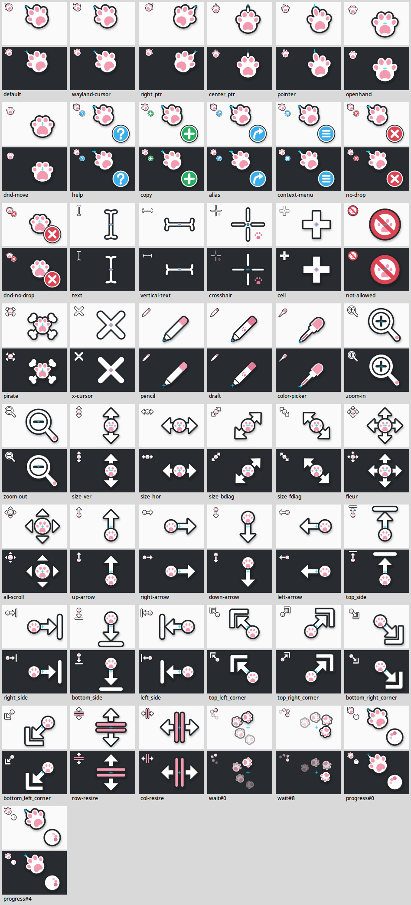

# Cat Paw cursors

Cursor theme for KDE Plasma 6: white cat paws with pink toe beans and a dark
outline, in the style and size of Breeze Light.

- `cursors_scalable/`: one SVG per shape (Plasma 6 scalable cursors, 32x32
  canvas at nominal size 24, like Breeze).
- `cursors/`: Xcursor fallback rendered from the same SVGs (sizes 24 to 96)
  for X11 and XWayland apps.
- All 47 Breeze shapes are drawn (including animated `wait` and `progress`),
  plus the same alias names; anything missing falls back to `breeze_cursors`.

## Build and install

Requires Python 3 with `pycairo` and the `Rsvg` GObject introspection bindings.

    ./install.sh                       # build + install to ~/.local/share/icons, linked from ~/.icons
    plasma-apply-cursortheme CatPaw    # apply
    ./preview.py preview.png 3         # contact sheet of every shape

All shapes are generated by `build.py`; edit it and rebuild rather than
editing the SVGs by hand.

This theme was developed with the help of an LLM (Claude).
