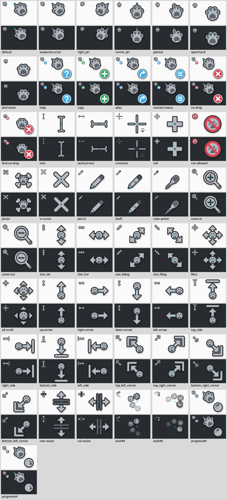
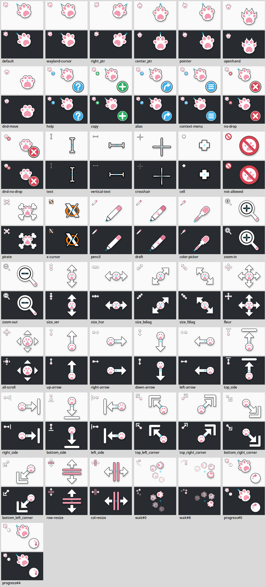

# Cat Paw cursors

Cursor theme for KDE Plasma 6: white cat paws with pink toe beans and a dark
outline, in the style and size of Breeze Light.

A grey variant, **Cat Paw Grey** (`CatPawGrey`), has the same shapes with grey
paws and dark grey beans, as a grey cat:

**Cat Paw Soft** (`CatPawSoft`) has the same white paws and pink beans with a
much thinner outline. Its link pointer is the open paw with one claw out (the claw
tip is the hotspot), and the open hand shows every claw. The shapes without a
paw (`text`, `vertical-text`, `crosshair`, `cell`, `x-cursor`) are taken
unchanged from Breeze Light at build time, so building this variant needs the
Breeze cursor theme installed (`/usr/share/icons/Breeze_Light`). Those Breeze
SVGs are by the KDE Visual Design Group, under the GNU GPL 2.0 or later.

- `cursors_scalable/`: one SVG per shape (Plasma 6 scalable cursors, 32x32
  canvas at nominal size 24, like Breeze).
- `cursors/`: Xcursor fallback rendered from the same SVGs (sizes 24 to 96)
  for X11 and XWayland apps.
- All 47 Breeze shapes are drawn (including animated `wait` and `progress`;
  Cat Paw Soft takes five of them from Breeze Light, see above), plus the
  same alias names; anything missing falls back to `breeze_cursors`.

## Build and install

Requires Python 3 with `pycairo` and the `Rsvg` GObject introspection bindings.

    ./install.sh [pink|grey|soft]      # build + install to ~/.local/share/icons, linked from ~/.icons
    plasma-apply-cursortheme CatPaw    # apply (CatPawGrey, CatPawSoft for the variants)
    ./preview.py preview.png 3 [pink|grey|soft]   # contact sheet of every shape

`build.py --variant grey` (or `soft`) builds only that variant into
`build/CatPawGrey` (or `build/CatPawSoft`). The colours and options of each
variant are in `VARIANTS` at the top of `build.py`.

All shapes are generated by `build.py`; edit it and rebuild rather than
editing the SVGs by hand.

This theme was developed with the help of an LLM (Claude).
