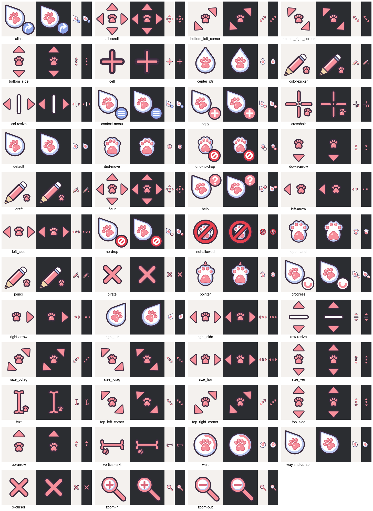

# Pastel Paws cursor theme

Cute pastel cat-paw cursors for KDE Plasma 6, drawn as SVG.



- `cursors_scalable/` – SVG cursors with `metadata.json` (Plasma ≥ 6.2 / KWin renders them sharp at any size and scale)
- `cursors/` – XCursor fallback (24–96 px) for XWayland, GTK and Electron apps
- Animated `wait` (16 frames) and `progress` (12 frames)
- Same cursor names and aliases as Breeze; anything missing falls back to `breeze_cursors`

Designs are drawn on a 32×32 canvas with nominal size 24, like Breeze, so at the default
size of 24 the paws are about as big as the Breeze arrow, a little larger.

## Build and install

```
./build.py --install     # writes build/PastelPaws and copies it to ~/.icons/PastelPaws
./preview.sh             # contact sheet of all cursors -> preview.png
```

Requires python3 and ImageMagick with librsvg (only to rasterize the XCursor fallback).
Then pick **Pastel Paws** in System Settings → Colors & Themes → Cursors.

Design inspired by the pastel paw cursor sets that circulate online; all shapes are drawn
from scratch by `build.py`.

This theme was developed with the help of an LLM (Claude).
